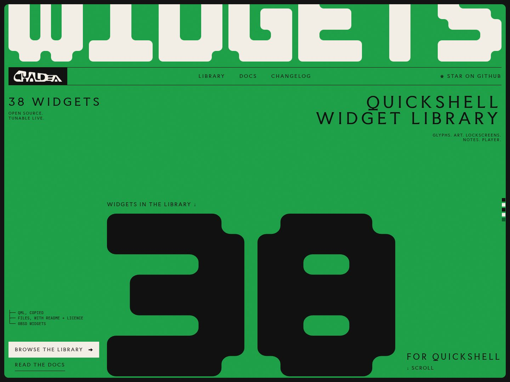

# Chaldea

Chaldea is an interactive widget library for Quickshell. Try a design in your browser, adjust its appearance, and export native QML for your Linux desktop.

[Download a packaged release](https://github.com/Aleph1-9012/Chaldea/releases/latest) for the source and a prebuilt static site snapshot. The live site may include newer changes.

[Browse the live library](https://chaldea.vercel.app).

The collection includes quick notes, media players, animated glyphs, interactive art, and lockscreen layouts. Every current catalog entry has a native QML export. See the [inventory](docs/widget-inventory.md) for the designs and current counts.

## Features

- Search by name, filter by family, and try widgets in live previews.
- Adjust colors, typography, layout, and motion through each widget's available settings.
- Copy generated QML or download individual output files, supporting assets, and licenses.
- Browse and customize without an account, telemetry, or saved visitor state.

## Widget families

| Family | What it provides |
| --- | --- |
| [Quick notes](widgets/quick-notes/README.md) | Compact note widgets with editing, selection, and in-memory note state. |
| [Player](widgets/player/README.md) | Media controls and artwork, with MPRIS integration in native exports. Browser previews use silent sample tracks. |
| [Glyphs](widgets/glyphs/README.md) | Drawings that respond to dummy input, deletion, and motion controls. |
| [Interactive art](widgets/interactive-art/README.md) | Interactive canvases with live controls and collections in the customization panel. |
| [Lockscreens](widgets/lockscreens/README.md) | One entry per layout, with native visual components and demo interactions. |

Lockscreen and Glyph previews do not authenticate or lock the desktop session. Those integrations belong in a separate host. Native requirements are listed in each widget's README; the shared Quickshell and Qt baseline is in [chaldea.toml](chaldea.toml).

## Use the library

1. Browse the collection and try a widget in its preview.
2. Adjust its available settings to fit your setup.
3. Choose an output file, then copy its text or download that file.

Save every file in the output selector: the generated QML, supporting files, the `shell.qml` preview launcher, `README.md`, and the applicable license. Preserve the listed file names and subfolders, including any images or audio. Follow the widget's README to try it or integrate it into your Quickshell configuration.

Settings and preview state stay in memory and reset when the preview is left or the page reloads.

## Browse locally

The public library runs at [chaldea.vercel.app](https://chaldea.vercel.app). You can also build and browse it locally.

Local setup requires GNU Make, a C compiler, and the pinned [Rust](rust-toolchain.toml) and [Bun](.bun-version) versions.

```sh
git clone https://github.com/Aleph1-9012/Chaldea.git
cd Chaldea
make setup
make dev
```

Open [localhost:5175](http://127.0.0.1:5175/) to browse the library.

`make dev` runs the Rust content packager, then Vite serves the site with the generated catalog and revision bundles. Frontend edits update through Vite. After editing files under `widgets/`, run `make content` and reload to use the new revisions.

## Development commands

Run these from the repository root:

| Command | Purpose |
| --- | --- |
| `make setup` | Check pinned tool versions and install frozen frontend dependencies. |
| `make dev` | Package local widgets and start the development server on port 5175. |
| `make content` | Rebuild packaged widgets after source changes. |
| `make check` | Run unit and code checks, build the site, and validate every widget and export. |
| `make test` | Rerun the Rust and Bun unit tests. |
| `make build` | Build the production site in `dist/`, excluding drafts. |
| `make preview` | Serve the existing production build on port 4173. |

`make check` already builds the production site. CI runs the same check and saves `dist/` as the `chaldea-site` artifact. Once the project is connected, Vercel's Git integration builds pushes to `main`, runs the same checks, and publishes the site while retaining previous widget revisions and application assets. Website updates do not require a version bump or GitHub release. See [deployment setup](docs/publishing.md). No browser is installed or launched by the checks.

The library checker discovers new widgets automatically and validates preview script syntax and declared assets, settings, generated files and asset bytes, and the production catalog. Inspect changed layouts and interactions in `make dev`; inspect changed native exports in an isolated Quickshell configuration.

## Project structure

The frontend uses Svelte 5 and TypeScript, built with Vite and managed with Bun. Rust validates and packages widget content at build time. The browser generates QML locally, so the site needs no separate runtime API server.

| Path | Contents |
| --- | --- |
| `backend/` | Rust source discovery, validation, and content packaging. |
| `frontend/` | Svelte 5 and TypeScript site, catalog client, QML generator, authoring scripts, and unit tests. |
| `widgets/` | Widget definitions, browser previews, native components, assets, and usage guides. |
| `schemas/` | Shared JSON contracts and cross-language fixtures. |
| `docs/` | Architecture, development, authoring, publication, and provenance records. |

Rust reads widget sources and packages revisions for the frontend. The browser and export scripts use the same QML generator. Widget folders declare the files they need; byte-identical helpers can resolve from a parent group's `_shared/` folder.

Generated content, build output, caches, and dependencies are ignored by Git. Keep `build/`, `dist/`, `backend/target/`, and `frontend/node_modules/` out of commits; change their sources and rebuild.

## Contributing

Follow the [roadmap](docs/roadmap.md) for planned work and the [widget authoring guide](docs/widget-guide.md) for adding designs or settings. Use the [development guide](docs/repair.md) for troubleshooting and manual export commands, and the [architecture guide](docs/architecture.md) for the packaging and preview contracts.

For production updates, follow the [publication requirements](docs/publishing.md), including retaining published revision URLs and verifying rollback.

## Support

If Chaldea is useful to you, you can support its development on [Ko-fi](https://ko-fi.com/aleph1_9012).

## License

The application is licensed under [Apache 2.0](LICENSE). Original widget code and assets use [0BSD](widgets/LICENSE). Third-party material retains its own terms. See [licensing](docs/licensing.md) for details.
